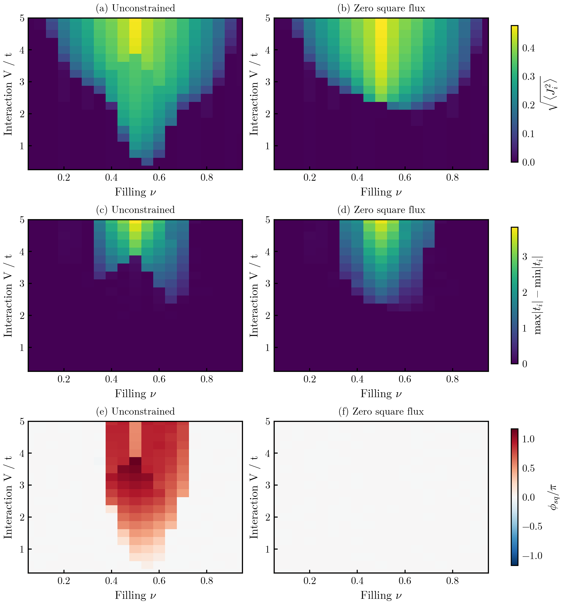
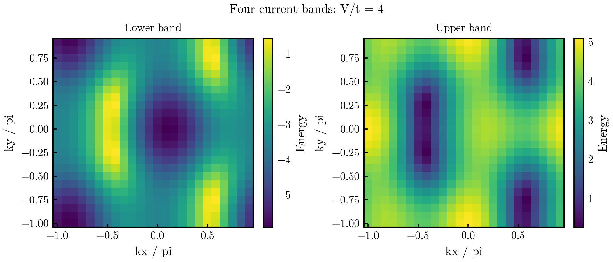

# Bond ordering in flux phases

Refactored author research code associated with Yifan Liu and Vivek Aji,
**Bond ordering in flux phases of interacting spinless fermions on the square
lattice**, Physical Review B **113**, 045140 (2026).
[DOI](https://doi.org/10.1103/3jqj-28q7) |
[arXiv:2402.09577](https://arxiv.org/abs/2402.09577).

This October 2026 release organizes the author's existing **four-current
research programs** into an import-safe package with explicit parameters,
separate optimization and plotting, examples and numerical checks. The author
confirmed the source project, but the exact historical version used to produce
the final paper figures is not known. This is a verified refactor of recovered
functions, not a claim to have recovered that final production version or to
have reproduced every published phase boundary.

This bond-order project is separate from the author's Affleck project.
No Affleck source or result files are included.

## Phase diagrams



The figure compares ordinary and zero-square-flux subspaces at t=1, t'=0.2,
with 19 fillings (.05 to .95), 20 interactions (.25 to 5), a 40x40 momentum
mesh, canonical occupation and RLEX symmetry constraints. Each subspace has
380 calculated parameter points. Color cells are not interpolated.

The scans start with SHGO (256 Sobol samples, two iterations), followed by
explicitly recorded admissible cross-subspace seeds, selected finer-grid
seeds and neighbor continuation. Raw independent scans are preserved.
The lower-energy feasible candidates are always evaluated at the actual
parameter point; neighboring or finer-grid values are never copied in as
interpolated energies. The audit includes the variational nesting check
and 12 selected 60x60-mesh / 512-sample / three-iteration refinement checks.
These are finite-grid maps, not certified phase boundaries or automatic
recovery of the paper's A-H labels.

[Four current maps, unrestricted square flux](docs/phase_diagrams/audited/unconstrained_order_parameters.png) |
[Four current maps, zero square flux](docs/phase_diagrams/audited/zero_flux_order_parameters.png) |
[Data and numerical audit](docs/phase_diagrams/README.md).

Generate the paired scans, audited figures and refinement checks:

```sh
OPENBLAS_NUM_THREADS=1 python -m examples.phase_diagrams
```

To regenerate the versioned figures from their saved raw scans:

```sh
OPENBLAS_NUM_THREADS=1 python -m examples.phase_diagrams --plot-only --output docs/phase_diagrams
```

## Run

Python 3.11 was used for validation. From this repository root:

```sh
python -m pip install -r requirements.txt
OPENBLAS_NUM_THREADS=1 python -m unittest discover -s tests -v
OPENBLAS_NUM_THREADS=1 python -m validation.run
OPENBLAS_NUM_THREADS=1 python -m bond_order.cli one-point
```

The default command uses mesh 24x24, t=1, t'=0.2, V=4, filling=0.4,
64 Sobol samples and one SHGO iteration. These are small workflow settings,
not publication convergence settings. It saves `one_point.json`, `bands.npz`
and `bands.png` to `examples/output/`. The JSON records requested and actual
filling, particle error, chemical potential, energy components, constraints,
solver settings, every sector's status, and whether a solver candidate or
the feasible zero-current baseline was selected.

For the zero-net-flux subspace:

```sh
OPENBLAS_NUM_THREADS=1 python -m bond_order.cli one-point --zero-flux \
  --occupation canonical --output examples/output/zero_flux
```

A small explicit sweep, saved incrementally:

```sh
OPENBLAS_NUM_THREADS=1 python -m bond_order.cli sweep \
  --fillings .3,.4,.5 --interactions 2,3,4 --occupation canonical \
  --mesh 24 --samples 64 --iterations 1 --output examples/output/sweep
```

Completed two-dimensional sweeps also save `phase_diagram.png` and `.svg`.
Use `--resume` to continue a compatible checkpoint; mismatched settings are
rejected. Plot a saved scan without repeating optimization:

```sh
python -m bond_order.cli plot-sweep --input examples/output/sweep/sweep.json \
  --output examples/output/sweep
```

All sweeps are serial and run only when requested. No top-level fitting,
optimization, multiprocessing, plotting or filesystem output occurs on
import. Matplotlib does not require TeX or a particular system font.
Optionally install the package with `python -m pip install -e .` to use the
`bond-order` command outside the repository root.

## Model and preserved numerical behavior

The four real current expectations J1,...,J4 refer to (+x,+y,-x,-y).
The model uses the paper's

```
t_nu = t + i V J_nu
E_+/- = -4 t' cos(kx) cos(ky) +/- |sum_nu t_nu exp(i k.e_nu)|
energy_per_site = V/4 sum_nu J_nu^2 + electronic_energy_per_site
```

`FluxModel.bands` retains the author's algebraically expanded E1/E2
expressions. `representation="complex"` gives the compact equivalent form,
also checked against independent Hermitian matrix diagonalization. A full
square Brillouin-zone mesh double counts the folded two-sublattice bands;
each entry carries weight 1/2. Filling is particles per physical site in [0,1].
Hopping, interaction, band energies and chemical potential use one common
energy unit. Current expectations and filling are dimensionless.

Two occupation modes are explicit:

* **`legacy` (default)** preserves the source's chemical-potential bisection,
  bracket [-1000,1000], E<=mu rule, 99-iteration limit and particle-count
  tolerance=3 (stopping tolerance is half that value). It precomputes the
  bands instead of recomputing them at every bisection step. Actual filling
  can differ from the target, especially at a degenerate shell; the difference
  and convergence status are saved.
* **`canonical`** is a separately labeled numerical improvement: sorted
  levels and fractional occupation of the last entry enforce the requested
  filling exactly on the discrete mesh. It can change finite-mesh objectives
  and optimized currents. It must not be silently substituted when comparing
  old output or claiming bit-for-bit reproduction of an old optimizer run.

Ordinary optimization defaults to the active RLEX constraints in the
parallel source. Zero-flux optimization defaults to the three LEX sectors
in the original zero-flux source, adding
`phi4-phi1+phi2-phi3=0`, where `phi_nu=atan(V*J_nu/t)`. It requires t>0.
`--symmetry rlex` or `--symmetry legacy_lex` makes the choice explicit.
The historical zero-flux LEX functions include a 1e-5 slack, even in the
J2-J1 equality; `legacy_lex` retains and reports it explicitly.
The refactored solver uses documented Sobol sampling; the older zero-flux
script's implicit SHGO defaults are retained only in the reference module.
This is not an assertion of identical minimizer paths across versions.

## Structure

| File | Responsibility |
|---|---|
| `bond_order/model.py` | Parameters, source band expressions, energy and flux |
| `bond_order/occupation.py` | Legacy and canonical filling algorithms |
| `bond_order/optimization.py` | SHGO, symmetry sectors, zero-flux constraint and solver diagnostics |
| `bond_order/plotting.py` | Figure creation without global plotting side effects |
| `bond_order/output.py` | Explicit JSON and numerical-array output |
| `bond_order/cli.py` | One-point and explicit sweep commands |
| `reference/` | Extracted original functions for comparison, with no top-level sweeps |
| `validation/` | Executable checks and measured JSON report |

## Evidence and scope

Four candidate source versions have identical E1/E2 function bodies but
different meshes, parameters, constraints or optimizer calls. The active
`parallel calculation_integral.py` candidate has t=1, t'=0.2, mesh 100x100
and RLEX/Sobol SHGO; the separate zero-flux candidate has the corresponding
three-sector constrained search. Neither is asserted to be the final version.
[The source audit](docs/source_audit.md) and
[source fingerprints](docs/source_manifest.json) record the selection.

At the validation points, the refactored bands agree with both recovered
references exactly in the tested environment, and the legacy-mode total
energies differ by at most 2.3e-16. Independent checks cover Hermitian
diagonalization, symmetry, folded counting, a known free-lattice continuum
energy, the RLEX region, and an occupation-degeneracy example. Small SHGO
runs exercise legacy/canonical filling and ordinary/zero-flux subspaces. The
versioned phase-map scans and their separate audit extend that bounded check
to the stated parameter grid; they do not identify historical figure versions.
See `validation/report.json` for all settings and results; this is bounded
evidence, not a universal equivalence or global-minimum certificate.

The calculations stay within the **loop-current mean-field ansatz**. There is
no CDW or other-order competition and no claim of the complete many-body
ground-state phase diagram. Existing adjacent exploratory CDW/three-band
programs and unverified historical plot outputs are not included. Published
phase labels are not inferred automatically from small example runs.

Use `citation.bib` or `CITATION.cff` to cite the associated paper.

## Generated example



## Figure exports

Figures now follow [publication template v0](docs/figure_style.md), with
LM Roman 10 text, Computer Modern mathematics, 10/9 pt typography and a
17.8 cm printed width. PDF, 300 dpi PNG, SVG and typography records accompany
the figures. The saved numerical data are unchanged.
