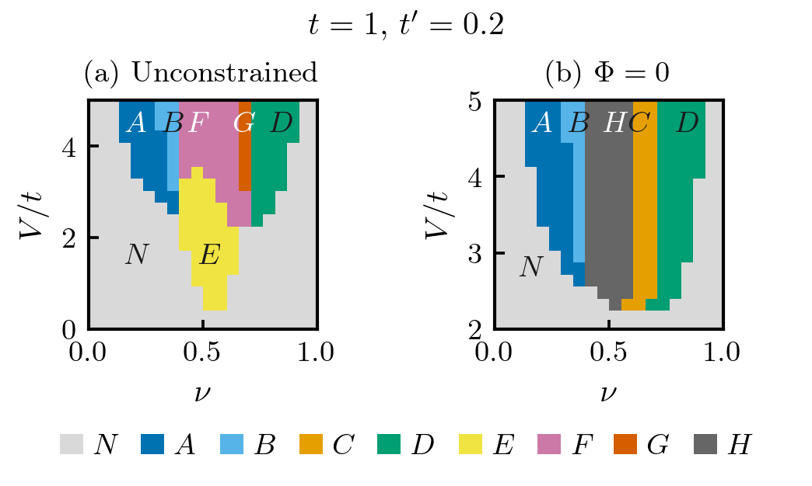

# Bond ordering in flux phases

Mean-field calculations of bond ordering and loop-current phases for
interacting spinless fermions on the square lattice. The calculations
accompany Y. Liu and V. Aji, *Physical Review B* **113**, 045140 (2026).



The phase-region maps above retain the classifications in the submitted
figures. Calculated current, bond-amplitude and flux maps are provided
separately below.

## Model and conventions

Four real bond currents $J_\nu$ describe links in the directions
$(+x,+y,-x,-y)$. The effective hopping and two mean-field bands are

$$
t_\nu=t+iVJ_\nu,\qquad
E_\pm(\mathbf{k})=-4t'\cos k_x\cos k_y
\pm\left|\sum_\nu t_\nu e^{i\mathbf{k}\cdot\mathbf{e}_\nu}\right|.
$$

The energy per site includes the current cost
$V\sum_\nu J_\nu^2/4$. The filling $\nu$ is the particle number per physical
site, between 0 and 1. Currents are dimensionless; $t$, $t'$, $V$, band
energies and chemical potential share one energy unit.
A full square Brillouin-zone mesh is used with weight $1/2$ for each folded
band entry.

For $t>0$, the link phases are $\phi_\nu=\arctan(VJ_\nu/t)$ and the square
flux is $\Phi\equiv\phi_4-\phi_1+\phi_2-\phi_3\pmod{2\pi}$. The plotted $\Phi/\pi$ lies in $[0,2)$. Both the unconstrained flux
ansatz and the $\Phi=0$ subspace can be optimized. The variational space
contains loop currents; competing charge-density order is outside this ansatz.

## Installation and a single parameter point

Python 3.11 is used for the numerical checks. From the repository root:

```sh
python -m pip install -r requirements.txt
OPENBLAS_NUM_THREADS=1 python -m bond_order.cli one-point \
  --occupation canonical --mesh 24 --samples 64 --iterations 1
```

This example uses $t=1$, $t'=0.2$, $V=4$ and $\nu=0.4$ and writes the
optimized currents, energy, solver diagnostics and band plots to
`examples/output/`. These mesh and search settings are intended for a short
example; convergence must be checked for a parameter study.

The zero-square-flux calculation is selected with:

```sh
OPENBLAS_NUM_THREADS=1 python -m bond_order.cli one-point \
  --zero-flux --occupation canonical --output examples/output/zero_flux
```

Figure export requires LaTeX with `latex`, `dvipng`, `type1cm`, `type1ec`,
`amsmath` and `textcomp`. On Ubuntu install
`texlive-latex-extra cm-super dvipng ghostscript`.

## Phase-space scans and figures

A small scan can be run as follows:

```sh
OPENBLAS_NUM_THREADS=1 python -m bond_order.cli sweep \
  --fillings .3,.4,.5 --interactions 2,3,4 --occupation canonical \
  --mesh 24 --samples 64 --iterations 1 --output examples/output/sweep
```

`--resume` continues a scan with matching parameters. To redraw the stored
figures in `docs/` without repeating optimization:

```sh
python -m examples.replot_saved
```


The saved calculations use $t=1$, $t'=0.2$, a $40\times40$ momentum mesh,
$19$ fillings from $0.05$ to $0.95$, and $20$ interactions from $0.25$ to $5$.
Each flux subspace contains 380 points. The plots show current strength,
bond-amplitude anisotropy and square flux. The historical N/A–H phase labels
are stored independently of these numerical order-parameter maps.

The paired calculations and their refinement checks can be regenerated with:

```sh
OPENBLAS_NUM_THREADS=1 python -m examples.phase_diagrams
```

See [the phase-diagram data guide](docs/phase_diagrams/README.md) for scan
settings, saved arrays and convergence checks, and
[the phase-region data](docs/phase_diagrams/historical_regions/README.md)
for the categorical maps.

## Occupation and minimization

`--occupation canonical` fixes the particle number by fractional occupation
of the last discrete level. `--occupation legacy`, the default, uses the
source chemical-potential bisection and particle-count tolerance. The
reported actual filling should be checked when using the latter, particularly
at degenerate levels.

SHGO searches the selected symmetry sectors. Unconstrained calculations use
RLEX sectors by default; the zero-flux calculation uses the original LEX
sectors unless `--symmetry` is specified. The `legacy_lex` constraints retain
the original $10^{-5}$ slack. Raw searches and subsequent feasible-seed
refinements are saved separately. Mesh and search convergence are needed
before interpreting a finite-grid boundary as a phase boundary.

## Numerical checks

```sh
python -m unittest discover -s tests -v
OPENBLAS_NUM_THREADS=1 python -m validation.run
```

The checks compare the expanded and complex-hopping band expressions,
independent Hermitian diagonalization, folded-band counting, symmetry and
occupation conventions. The phase-map audit also compares the energies in
the nested variational spaces and selected finer meshes. Settings and
residuals are recorded in [validation/report.json](validation/report.json)
and [the scan audit](docs/phase_diagrams/audit.json).

The figures use the shared [publication style](docs/figure_style.md).
Source and numerical details are collected in [docs/](docs/source_audit.md).
The independent [Affleck project](https://github.com/lyfstefan/1988_Affleck)
uses a separate model and dataset.

## Reference

Yifan Liu and Vivek Aji, “Bond ordering in flux phases of interacting spinless
fermions on the square lattice,” *Phys. Rev. B* **113**, 045140 (2026).
[DOI:10.1103/3jqj-28q7](https://doi.org/10.1103/3jqj-28q7) ·
[arXiv:2402.09577](https://arxiv.org/abs/2402.09577).
BibTeX and citation metadata are provided in `citation.bib` and `CITATION.cff`.
